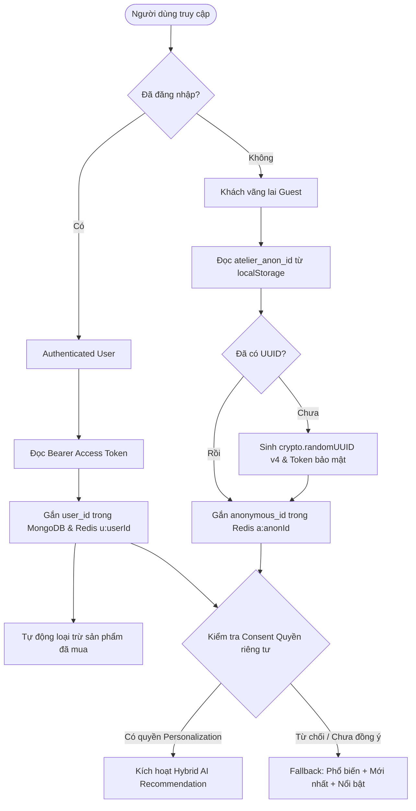

# BÁO CÁO AUDIT HỆ THỐNG GỢI Ý & THEO DÕI HÀNH VI (HOME RECOMMENDATION AUDIT)
*Dự án: ATELIER VÉRITÉ — Kiến trúc Fashion E-Commerce ThreeUI*
*Ngày thực hiện: 17/11/2026*
*Tài liệu đối chiếu: Law 91/2025/QH15, Decree 356/2025/NĐ-CP, PROJECT_HANDOVER.md, Backend Codebase tại `backend/src/`*

---

## 1. TỔNG QUAN HỆ THỐNG & ĐẶC TẢ KIẾN TRÚC

Hệ thống gợi ý sản phẩm cho trang chủ (Home Page) của **ATELIER VÉRITÉ** được xây dựng theo mô hình **Hybrid Recommendation Architecture (Đa tầng lai ghép)**, kết hợp giữa:
1. **Behavioral Profile (Hồ sơ sở thích hành vi)**: Tính điểm quan tâm theo danh mục (Category Affinity), từ khóa tìm kiếm (Keyword Match), kích cỡ (Size Affinity), màu sắc (Color Affinity) và khoảng giá (Price Range).
2. **Vector AI Semantic Search**: Độ tương đồng cosine trên không gian vector embeddings của sản phẩm.
3. **Business & Merchandising Rules**: Bán chạy (Best-Selling), Tác phẩm mới ra mắt (New Arrivals), Sản phẩm trình diễn Runway/Chiến dịch khuyến mãi (Featured Campaigns).
4. **Privacy & Consent Compliance Gate**: Tuân thủ triệt để Luật Bảo vệ dữ liệu cá nhân 91/2025/QH15 và Nghị định 356/2025/NĐ-CP — Không kích hoạt cá nhân hóa khi người dùng chưa cấp quyền hoặc đã từ chối mục đích *Personalization*.

---

## 2. KIỂM TOÁN CÁC API THỰC TẾ TRONG BACKEND

| Endpoint API | Phương thức | Quyền truy cập | Nguồn dữ liệu Backend | Mô tả chức năng & Kết quả trả về |
| :--- | :---: | :---: | :--- | :--- |
| `/api/recommendations` | `GET` | `optionalProtectedRoute` (Guest & User) | `recommendation.service.js` | **API gợi ý trung tâm**. Nhận query `limit`, `anonymous_id`, header `x-anonymous-id` và Bearer JWT. Trả về `mode` (`personalized` / `popular` / `empty`), `algorithm`, mảng `products` đã tính giá/tồn kho và thông tin `experiment` (A/B testing). |
| `/api/events` | `POST` | `optionalProtectedRoute` | `tracking.service.js` | Tiếp nhận đơn sự kiện hoặc batch sự kiện (tối đa 25 sự kiện/request). Validate định dạng UUID, loại trừ sự kiện server-only, cập nhật hồ sơ `UserInterestProfile` bất đồng bộ qua BullMQ worker. |
| `/api/events/track` & `/api/events/batch` | `POST` | `optionalProtectedRoute` | `tracking.service.js` | Alias tương thích ngược của `/api/events`. |
| `/api/events/consent` | `GET` & `POST` / `PUT` | `optionalProtectedRoute` | `userConsent.model.js` | Đọc và cập nhật trạng thái đồng thuận quyền riêng tư vào MongoDB và Redis cache `consent:denied:{id}`. |
| `/api/events/me` | `DELETE` | `optionalProtectedRoute` | `tracking.service.js` | Xóa sạch toàn bộ lịch sử hành vi `UserEvent` và hồ sơ `UserInterestProfile` của User hoặc Guest (Quyền được xóa dữ liệu). |
| `/api/search/history` | `GET` & `DELETE` | `protectedRoute` | `searchHistory.route.js` | Lấy 10 từ khóa tìm kiếm gần nhất không trùng của người dùng hoặc xóa toàn bộ lịch sử từ khóa. |
| `/api/products` | `GET` | Public | `product.controller.js` | Lấy danh sách sản phẩm theo bộ lọc `category`, `sort`, `limit`, `page`. Cache Redis 10 phút. |
| `/api/products/search` | `GET` | Public | `product.controller.js` | Tìm kiếm sản phẩm theo từ khóa văn bản và danh mục. |
| `/api/products/:slug` | `GET` | Public | `product.controller.js` | Xem chi tiết sản phẩm đơn lẻ kèm biến thể và tồn kho. |
| `/api/products/:id/availability` | `GET` | Public | `inventory.controller.js` | Kiểm tra tồn kho khả dụng thời gian thực (`available: boolean`, `stock: number`). |

> [!IMPORTANT]
> Backend **KHÔNG CÓ** các endpoint giả định như `/api/products/trending` hay `/api/products/best-sellers` riêng biệt. Thay vào đó, API chuẩn hóa duy nhất của hệ thống là `GET /api/recommendations?limit=...` kết hợp cùng `GET /api/products?sort=...`. Hệ thống Frontend phải kết nối trực tiếp vào các API thực tế này.

---

## 3. EVENT TAXONOMY & ĐIỂM TRỌNG SỐ HÀNH VI (BEHAVIORAL SCORING)

Backend tại `backend/src/modules/tracking/tracking.constants.js` quy định cấu trúc phân loại sự kiện và thang điểm (Event Weights):

### 3.1. Nhóm tín hiệu ý định cao (High Intent Signals)
- `purchase_completed` / `order_placed`: Trọng số **+5.0** (Chỉ ghi nhận từ Server, client không được gửi trực tiếp).
- `add_to_cart`: Trọng số **+3.0** (Người dùng thêm sản phẩm vào giỏ hàng).
- `product_favorite` / `wishlist_added`: Trọng số **+3.0** (Lưu vào danh sách mong muốn).
- `checkout_started`: Trọng số **+2.5** (Bắt đầu quy trình thanh toán).

### 3.2. Nhóm tín hiệu quan tâm tích cực (Active Interest Signals)
- `search_result_click`: Trọng số **+2.0** (Nhấn vào sản phẩm từ kết quả tìm kiếm).
- `product_click`: Trọng số **+1.5** (Nhấn vào thẻ sản phẩm từ danh mục hoặc trang chủ).
- `search_performed`: Trọng số **+1.5** (Thực hiện tìm kiếm từ khóa thời trang).
- `product_view`: Trọng số **+1.0** (Truy cập và xem chi tiết sản phẩm trên 3 giây).
- `category_view`: Trọng số **+1.0** (Duyệt bộ sưu tập hoặc danh mục).
- `recommendation_clicked`: Trọng số **+1.5** (Tương tác với sản phẩm trong khối đề xuất).

### 3.3. Cơ chế giảm chấn & Chống bất thường (Decay & Anti-Spam)
- **Time Decay**: Điểm sở thích giảm dần theo hàm số mũ sau mỗi 7 và 30 ngày không tương tác.
- **Click Debounce & Clamping**: Các click lặp liên tiếp vào cùng một sản phẩm trong thời gian ngắn (< 1000ms) bị chặn bởi Rate Limiter (120 req/phút/IP) và không cộng dồn điểm bất thường.
- **Exclusion Filter**: Tự động loại trừ tối đa 3 sản phẩm vừa xem ngay lập tức để tránh nhàm chán, và loại trừ 100% các sản phẩm đã đặt mua thành công trong lịch sử đơn hàng.

---

## 4. CƠ CHẾ ĐỊNH DANH GUEST & AUTHENTICATED USER

### 4.1. Khách vãng lai (Guest)
- Lưu `atelier_anon_id` (định dạng UUID v4 hợp lệ theo chuẩn RFC 4122) trong `localStorage`.
- Kèm theo `atelier_anon_token` ngẫu nhiên để xác thực quyền xóa dữ liệu riêng mà không cần đăng nhập.
- Truy vấn đề xuất với header `X-Anonymous-ID` hoặc query param `?anonymous_id=...`.
- Tuyệt đối không can thiệp hay đọc trộm hồ sơ hành vi của khách khác.

### 4.2. Khách hàng thành viên (Authenticated User)
- Truy vấn gửi kèm Bearer JWT Token (`Authorization: Bearer <token>`).
- Backend tự động trích xuất `user_id`, kết nối tới `UserInterestProfile` của tài khoản.
- Khi người dùng đăng xuất (`logout`):
  - Frontend dọn sạch bộ nhớ cache và state cá nhân hóa của tài khoản.
  - Chuyển phiên làm việc về Guest với `anonymous_id` độc lập.

---

## 5. MA TRẬN TUÂN THỦ PHÁP LÝ & QUYỀN RIÊNG TƯ (CONSENT MATRIX)

Theo quy định bắt buộc của **Luật Bảo vệ dữ liệu cá nhân 91/2025/QH15** và **Nghị định 356/2025/NĐ-CP**:

| Trạng thái Consent của Người dùng | Mục đích Cá nhân hóa (Personalization) | Hành vi của Hệ thống Gợi ý (Home Recommendation) |
| :--- | :---: | :--- |
| **Chưa lựa chọn (First Visit / Banner Open)** | **BLOCKED (Chặn)** | Không thu thập dữ liệu hành vi. Trang chủ hiển thị 100% Fallback: *Tác phẩm mới ra mắt* (New Arrivals), *Kiểu dáng bán chạy* (Best-Sellers), *Bộ sưu tập Runway nổi bật*. |
| **Từ chối (Reject All / Essential Only)** | **BLOCKED (Chặn)** | Backend ghi nhận `consent: "denied"`. API `/api/recommendations` tự động trả về `mode: "popular"`. Không ghi nhận log hành vi sở thích. |
| **Chỉ chấp nhận Analytics (Custom)** | **BLOCKED (Chặn)** | Cho phép đếm lượt xem tổng hợp, nhưng **chặn tuyệt đối việc tạo hồ sơ hành vi cá nhân hóa**. Hệ thống tiếp tục dùng Fallback tổng quan. |
| **Đồng ý đầy đủ (All Accepted / Custom có Personalization)** | **GRANTED (Cho phép)** | Thu thập và xử lý hành vi hợp pháp. Gọi `GET /api/recommendations` trả về khối *Dành riêng cho quý khách* (Personalized Couture Curation). |
| **Rút lại sự đồng ý (Withdrawn Consent)** | **REVOKED (Thu hồi)** | Ngay lập tức xóa cache cá nhân hóa ở Frontend, chuyển đổi giao diện về Fallback, thông báo đồng bộ lên Backend qua `PUT /api/privacy/consent`. |

---

## 6. KẾT LUẬN & ĐỀ XUẤT KIẾN TRÚC CHO TRANG CHỦ

1. **Tích hợp API chuẩn**: Sử dụng trực tiếp `GET /api/recommendations` từ backend cho khu vực cá nhân hóa, kết hợp `GET /api/products` cho các tab phổ biến.
2. **Thiết kế UI Tabbed Luxury**: Thay vì tạo 4 danh sách dài gây tràn trang và trùng lặp sản phẩm, thiết kế khu vực sản phẩm trung tâm với hệ thống Tab tuyển chọn:
   - **Tab 1: Dành riêng cho quý khách (Bespoke Curation)**: Kích hoạt khi có consent và có dữ liệu hành vi; nếu chưa có, hiển thị giao diện tuyển chọn thanh lịch.
   - **Tab 2: Tác phẩm thịnh hành (Trending Silhouettes)**: Sản phẩm có lượt xem và đánh giá cao.
   - **Tab 3: Bán chạy nhất (Maison Best-Sellers)**: Dựa trên số lượng bán thực tế (`sold`).
   - **Tab 4: Tác phẩm mới ra mắt (New Arrivals)**: Sắp xếp theo ngày ra mắt mới nhất (`createdAt`).
3. **Thực thi bộ nhớ đệm (Caching & Debouncing)**: Cache kết quả trong 3 phút, hủy request trùng lặp khi người dùng chuyển tab nhanh, không N+1 request.
4. **Việt hóa chuẩn mực**: Toàn bộ nhãn, thông điệp, trạng thái hiển thị bằng tiếng Việt sang trọng đúng tinh thần Haute Couture; toàn bộ mã nguồn, biến, component dùng tiếng Anh kỹ thuật.
