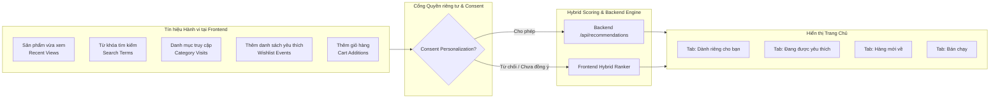

# THIẾT KẾ HỆ THỐNG GỢI Ý THÔNG MINH TRANG CHỦ (HOME RECOMMENDATION DESIGN)
*Dự án: ATELIER VÉRITÉ — Kiến trúc Fashion E-Commerce ThreeUI*
*Tác giả: Senior Fullstack Engineer, Recommendation Systems Engineer & Creative Director*
*Ngày phê duyệt: 17/11/2026*

---

## 1. NGUYÊN TẮC THIẾT KẾ (DESIGN PRINCIPLES)

1. **Luxury Editorial & ThreeUI Aesthetic**: Duy trì chuẩn mực thẩm mỹ thời trang cao cấp Paris/Milan/Tokyo, phông chữ có chân nghệ thuật (Serif), tỷ lệ khung hình chuẩn ảnh editorial (4:5 hoặc 3:4), chuyển động mượt mà không gây giật khung hình.
2. **Behavioral Intelligence Without Privacy Invasion**: Khai thác dữ liệu hành vi thực tế (sản phẩm đã xem, danh mục quan tâm, từ khóa tìm kiếm) nhưng đặt dưới sự kiểm soát tuyệt đối của người dùng theo Luật 91/2025/QH15.
3. **Zero WebGL Bloat**: Không khởi tạo WebGL canvas riêng rẽ trên từng product card; chỉ dùng một ThreeUI Hero canvas duy nhất ở đầu trang; toàn bộ khối card sử dụng CSS hardware-accelerated transitions.
4. **Intelligent Tabbed Curation**: Thay vì xếp chồng 4 danh sách dài gây nhàm chán và lặp sản phẩm, tổ chức khối sản phẩm trung tâm với hệ thống Tab tuyển chọn linh hoạt:
   - **Dành riêng cho quý khách (Bespoke Curation)**
   - **Kiểu dáng thịnh hành (Trending Silhouettes)**
   - **Tác phẩm mới ra mắt (New Arrivals)**
   - **Tác phẩm bán chạy (Maison Best-Sellers)**
5. **Multi-tier Failover Resilience**: Đảm bảo trang chủ không bao giờ bị trống hoặc báo lỗi; tự động chuyển sang danh sách sản phẩm chuẩn hóa nếu Backend gặp sự cố hoặc timeout.

---

## 2. KIẾN TRÚC TÍN HIỆU HÀNH VI (BEHAVIORAL SIGNAL ARCHITECTURE)

### 2.1. Phân biệt tín hiệu gần đây (Recent) và thường xuyên (Frequent)
- **Hành vi gần đây (Recent Behavior — 35%)**:
  - Ghi nhận 5 sản phẩm tương tác gần nhất trong phiên làm việc hiện tại.
  - Từ khóa vừa gõ tại QuickSearch modal.
  - Phân loại danh mục vừa xem tại thanh điều hướng hoặc menu bộ sưu tập.
- **Hành vi thường xuyên (Frequent Behavior — 25%)**:
  - Tần suất tương tác với danh mục (`category_scores`).
  - Tần suất thêm vào Wishlist hoặc Giỏ hàng (`cart` / `wishlist`).
- **Tín hiệu phổ biến & mới về (Popularity & Recency — 30%)**:
  - Số lượng bán thực tế (`sold`) từ cơ sở dữ liệu.
  - Ngày ra mắt sản phẩm (`createdAt`) cho hàng mới về.
- **Tín hiệu biên tập & tồn kho (Availability & Merchandising — 10%)**:
  - Chỉ ưu tiên sản phẩm có trạng thái `inStock: true` và `stockCount > 0`.
  - Sản phẩm trình diễn Runway FW26 hoặc thuộc chiến dịch trọng điểm.

---

## 3. THIẾT KẾ PRODUCT CARD & TRẠNG THÁI HIỂN THỊ

Mỗi thẻ sản phẩm trong khối đề xuất đáp ứng đầy đủ các tiêu chuẩn:
- **Tỷ lệ ảnh Editorial**: Khung hình `4:5`, tự động tải ảnh góc nhìn thứ hai khi di chuột (Secondary Image Hover Reveal).
- **Nhãn đặc quyền (Badge)**: Hiển thị tinh tế góc trái (`Mùa mới`, `Runway FW26`, `Bán chạy nhất`, `Độc bản`).
- **Nút yêu thích tương tác nhanh (Wishlist)**: Trái tim viền mạ vàng / đổi màu khi đã lưu.
- **Nút thêm nhanh vào túi (Quick Add)**: Cho phép chọn size nhanh trực tiếp trên card mà không cần rời trang chủ.
- **Thông tin minh bạch**: Tên tiếng Việt có dấu, định dạng giá VND (`formatCurrency`), nhãn tồn kho (`Còn hàng` / `Chỉ còn X tác phẩm`).
- **Skeleton Loading State**: Khung chờ xung nhịp mờ ảo (Pulse Shimmer) khi tải dữ liệu API.
- **Empty & Error States**: Thông báo trang nhã kèm nút *Khám phá bộ sưu tập toàn diện*.

---

## 4. CHIẾN LƯỢC BỘ NHỚ ĐỆM & HIỆU NĂNG (PERFORMANCE & CACHING)

1. **Request Deduplication & AbortController**:
   - Khi chuyển tab giữa *Dành riêng cho bạn* và *Bán chạy*, các request trước đó được tự động `abort` để tránh ghi đè dữ liệu sai thời điểm.
2. **Client-side Memory Cache (3 phút)**:
   - Lưu trữ kết quả API đề xuất theo khóa `rec_${identity}_${tab}_${limit}` trong bộ nhớ 180 giây.
   - Tránh gọi lại API khi người dùng chỉ chuyển đổi qua lại giữa các tab.
3. **Thanh lọc khi đăng xuất (Logout Purge)**:
   - Lắng nghe sự kiện đăng xuất từ `useAuthStore`.
   - Ngay lập tức xóa bỏ toàn bộ cache đề xuất và lịch sử hành vi của tài khoản, chuyển trạng thái đề xuất về Guest.
4. **Thanh lọc khi rút lại Consent (Consent Withdrawal Purge)**:
   - Khi `useConsentStore` chuyển trạng thái `personalization: false`, xóa sạch cache cá nhân hóa và tự động chuyển tab hiển thị sang *Kiểu dáng thịnh hành*.
