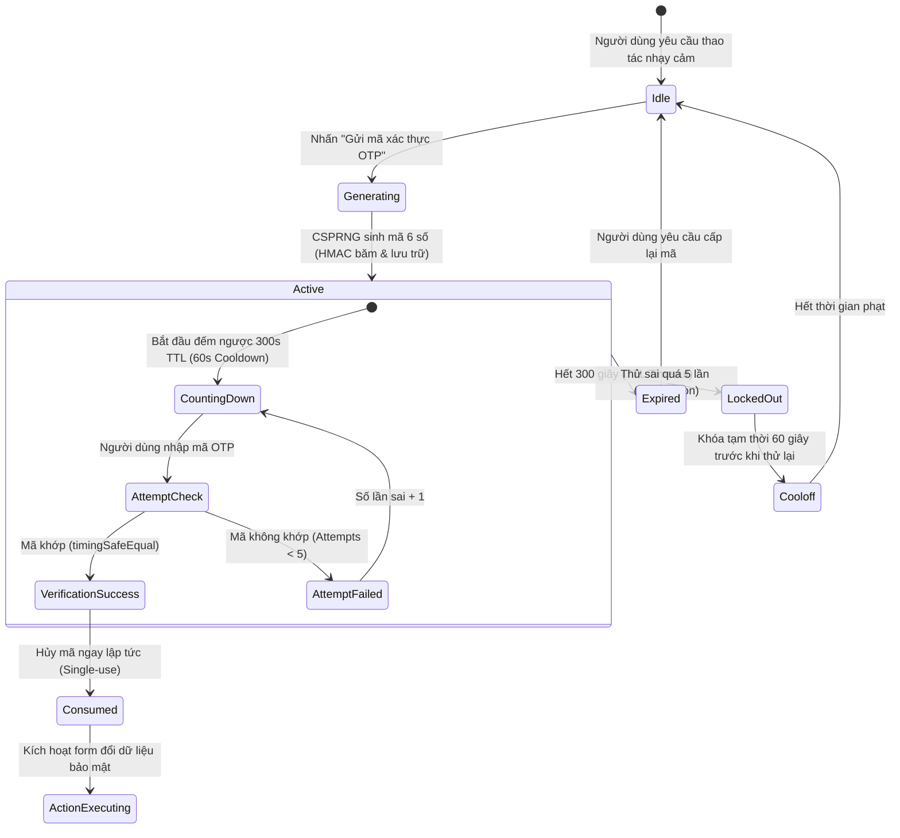
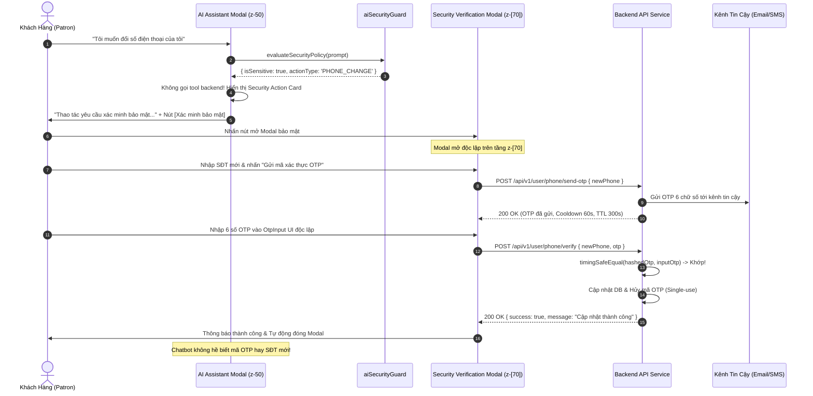

# QUY TRÌNH KIẾN TRÚC XÁC THỰC OTP & BẢO MẬT TÀI KHOẢN (PHASE 14)

**Dự án**: ThreeUI Fashion E-Commerce Storefront (*Atelier Vérité*)  
**Mô-đun**: Security Verification & OTP Protocol  
**Tác giả**: IAM Architect & Security Engineer  
**Ngày phát hành**: 17/11/2026  

---

## 1. TỔNG QUAN KIẾN TRÚC XÁC THỰC OTP (OTP ARCHITECTURE)

Quy trình xác thực mã dùng một lần (OTP - One-Time Password) tại Atelier Vérité được thiết kế tuân thủ các tiêu chuẩn bảo mật quốc tế (NIST SP 800-63B - Digital Identity Guidelines) và luật bảo vệ dữ liệu Việt Nam (Luật An ninh mạng, Luật 91/2025/QH15).

Hệ thống bảo đảm 5 nguyên tắc cốt lõi:
1. **Cryptographic Randomness**: Mã OTP sinh từ CSPRNG (Cryptographically Secure Pseudo-Random Number Generator).
2. **Zero Cleartext Storage**: Không lưu trữ mã OTP dạng thô; chỉ lưu băm HMAC-SHA256 kèm muối bí mật trên máy chủ.
3. **Timing-Attack Resistance**: So sánh chuỗi nhị phân bằng hàm thời gian không đổi `timingSafeEqual`.
4. **Strict Life-Cycle Policy**: Vòng đời 300 giây (5 phút), giới hạn 5 lần nhập sai, giãn cách gửi lại (cooldown) 60 giây.
5. **Zero-Knowledge AI Boundary**: AI Agent tuyệt đối không tiếp cận, không xử lý, không lưu vết mã OTP hoặc mật khẩu.

---

## 2. VÒNG ĐỜI VÀ MÔ HÌNH TOÁN HỌC CỦA MÃ OTP



### 2.1. Chi Tiết Thuật Toán Mã Hóa (Backend `otp.service.js`)
- **Sinh mã**:
  ```javascript
  const otpCode = crypto.randomInt(100000, 1000000).toString(); // Đảm bảo đúng 6 chữ số ngẫu nhiên
  ```
- **Băm bảo vệ (HMAC-SHA256)**:
  ```javascript
  const hashedOtp = crypto
    .createHmac('sha256', process.env.OTP_SECRET)
    .update(otpCode)
    .digest('hex');
  ```
- **Xác minh kháng Timing Attack**:
  ```javascript
  const inputHashed = crypto.createHmac('sha256', process.env.OTP_SECRET).update(inputOtp).digest('hex');
  const isMatch = crypto.timingSafeEqual(Buffer.from(hashedOtp), Buffer.from(inputHashed));
  ```

---

## 3. LUỒNG TƯƠNG TÁC GIỮA AI AGENT, GIAO DIỆN VÀ BACKEND

### 3.1. Phân Tách Tuyệt Đối Ngữ Cảnh (Separation of Concerns)



---

## 4. CHI TIẾT TỪNG LUỒNG THAO TÁC NHẠY CẢM

### 4.1. Luồng Đổi Mật Khẩu (Password Change Flow)
Khi khách hàng yêu cầu đổi mật khẩu:
1. **Kiểm tra đăng nhập**: Hệ thống xác thực token phiên trong `useAuthStore`. Nếu chưa đăng nhập, hướng dẫn chuyển tới trang `/auth/login`.
2. **Kích hoạt Form Đổi Mật Khẩu Bảo Mật**:
   - Sử dụng component `ChangePasswordForm`.
   - Thu thập:
     - `currentPassword`: Mật khẩu hiện tại của người dùng.
     - `newPassword`: Mật khẩu mới (áp dụng thanh đo độ mạnh mật khẩu `PasswordStrengthMeter`: tối thiểu 8 ký tự, chữ hoa, chữ thường, số, ký tự đặc biệt).
     - `confirmPassword`: Xác nhận khớp mật khẩu mới.
   - Các trường nhập liệu được mã hóa che ký tự (`type="password"`), có nút toggle hiện/ẩn cục bộ trong DOM của form.
3. **Gửi API Trực Tiếp**:
   - Gửi yêu cầu qua `POST /api/v1/user/updatePassword` với payload `{ currentPassword, newPassword }`.
   - Tuyệt đối không lưu mật khẩu vào `localStorage` hay biến trạng thái toàn cục.
4. **Thông Báo & Vô Hiệu Hóa Phiên**:
   - Hiển thị cảnh báo bảo mật: *"Khuyên dùng: Đăng xuất khỏi tất cả các thiết bị khác sau khi đổi mật khẩu"*.

### 4.2. Luồng Đổi Số Điện Thoại (Phone Change Flow - Full Native OTP)
1. **Thu thập số điện thoại mới**:
   - Xác thực định dạng số điện thoại Việt Nam chuẩn (`/(84|0[3|5|7|8|9])+([0-9]{8})\b/`).
2. **Kích hoạt gửi OTP**:
   - Gọi `sendPhoneUpdateOtp(newPhone)` -> `POST /api/v1/user/phone/send-otp`.
   - Bắt đầu bộ đếm ngược 60 giây cho nút gửi lại mã.
   - Bắt đầu bộ đếm ngược TTL 300 giây cho phiên xác thực.
3. **Nhập OTP trực tiếp qua `OtpInput`**:
   - 6 ô nhập riêng biệt hỗ trợ tự động nhảy ô, phím Backspace, mũi tên trái/phải, và dán mã tự động (Paste 6 digits).
   - Tự động lọc chỉ cho phép số nguyên dương (`0-9`).
4. **Xác thực và cập nhật số điện thoại**:
   - Khi đủ 6 chữ số, gọi `verifyAndUpdatePhone(newPhone, otp)` -> `POST /api/v1/user/phone/verify`.
   - Nếu thành công: Cập nhật thông tin profile trong auth store và đóng modal.

### 4.3. Luồng Đổi Địa Chỉ Email (Email Change Flow - Security & Gap Handling)
1. **Thẩm định an ninh**:
   - Kiểm tra khả năng hỗ trợ của Backend: Hiện tại Backend chỉ cung cấp endpoint `/user/updateProfile` cho phép đổi email mà KHÔNG có cơ chế gửi OTP xác thực đến email cũ hoặc mới.
2. **Cơ chế bảo vệ nâng cao (Phase 14 Enforcement)**:
   - Hệ thống đánh dấu trạng thái `BLOCKED_BY_BACKEND` cho việc đổi email tự động mà không có OTP.
   - Giao diện `ChangeEmailForm` thông báo minh bạch cho Patron:
     > *"Chính sách bảo mật Haute Couture: Để bảo vệ an toàn tối đa cho tài khoản, việc thay đổi email định danh chính thức yêu cầu xác minh hai chiều từ cả email cũ và email mới. Vui lòng liên hệ Trợ lý Atelier hoặc Chuyên viên Bảo mật để được hỗ trợ thủ công."*

---

## 5. THIẾT KẾ TRẢI NGHIỆM NGƯỜI DÙNG & CHỐNG TẤN CÔNG (UX & RESILIENCY)

| Nguy cơ bảo mật | Biện pháp phòng vệ Frontend & UX |
|---|---|
| **Brute-force OTP** | Giới hạn 5 lần thử sai. Mỗi lần sai hiển thị số lượt thử còn lại. Đạt 5 lần -> khóa tạm 60s và bắt buộc yêu cầu mã mới. |
| **Spam gửi mã OTP** | Khóa nút "Gửi lại mã" với bộ đếm Cooldown 60s hiển thị rõ ràng trên giao diện. |
| **Mã OTP lưu lại sau khi dùng** | Hủy toàn bộ giá trị trong state của `OtpInput` ngay khi hoàn tất hoặc modal bị đóng. |
| **Chụp trộm màn hình / Đọc lén DOM** | Input mật khẩu luôn được che giấu (`type="password"`, `autocomplete="new-password"`). Input OTP không hiển thị trong URL hay chat transcript. |
| **Z-Index Layer Conflict** | Modal bảo mật được ghim tại `z-[70]`, đè lên trên `AiAssistantModal` (`z-50`) và Header/Navigation (`z-40`), đảm bảo người dùng tập trung tuyệt đối và không bị chặn sự kiện click. |
| **Hết hạn phiên (Session Expiration)** | Hiển thị màn hình `VerificationExpiredState` khi hết 300s với nút làm mới 1-chạm giúp người dùng thao tác lại dễ dàng. |
