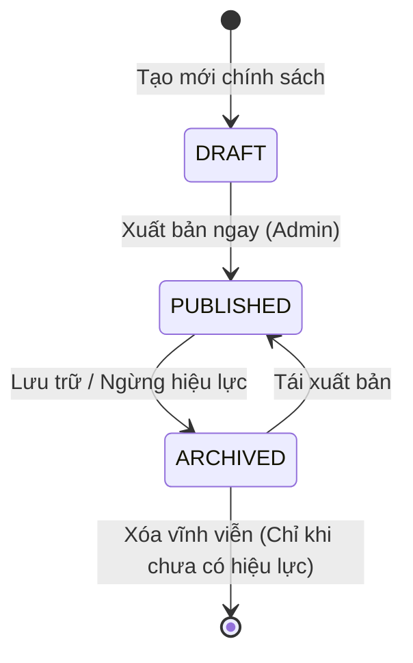

# Enterprise Policy Management System — Architecture & Operations

## 1. Overview
The **Policy Management System** (`/admin/policies`) provides Atelier Vérité administrators with complete governance over enterprise legal documents, consumer terms, cookie disclosures, and privacy notices. Designed in accordance with Vietnamese legal mandates (Decree 13/2023/NĐ-CP, Law 91/2025/QH15 on Consumer Protection, and Decision 749/QĐ-TTg) and international standards (GDPR/ePrivacy), the system ensures that customer-facing legal content remains synchronized, auditable, and secure.

---

## 2. Architecture & Routes

| Route | Component | Purpose | Access Control |
|---|---|---|---|
| `/admin/policies` | `AdminPoliciesPage` | Tabular policy inventory, filtering, lifecycle action controls, search, pagination | Admin, Superadmin |
| `/admin/policies/new` | `AdminPolicyCreatePage` | New policy creation form with WYSIWYG editor, tag taxonomy, and draft controls | Admin, Superadmin |
| `/admin/policies/:id/edit` | `AdminPolicyEditPage` | Policy revision editor with live change tracking and dirty-state protection | Admin, Superadmin |
| `/admin/policies/:id/history` | `AdminPolicyHistoryPage` | Version audit trail, change logs, and rollback/restoration interface | Admin, Superadmin |

---

## 3. Supported Policy Types & Taxonomy
The system categorizes enterprise policies into 8 official legal documents:
1. **Chính sách bảo mật (Privacy Policy)**: Governs personal data processing, retention, third-party disclosure, and subject rights. Public slug: `privacy-policy`.
2. **Điều khoản dịch vụ (Terms of Service)**: Governs site access, intellectual property, user responsibilities, and dispute resolution. Public slug: `terms-of-service`.
3. **Chính sách Cookie (Cookie Policy)**: Details technical session cookies, analytical telemetry, and marketing pixel trackers with category granular opt-ins. Public slug: `cookie-policy`.
4. **Chính sách đổi trả & hoàn tiền (Returns & Refunds)**: Outlines 14-day return windows, condition criteria, and refund timeline SLA. Public slug: `returns-refunds`.
5. **Chính sách vận chuyển & giao hàng (Shipping Policy)**: Delivery methods, standard/express freight rates, logistics partner SLAs. Public slug: `shipping-policy`.
6. **Chính sách thanh toán (Payment Policy)**: Guidelines for COD, VNPay, MoMo QR, card validation, and chargebacks. Public slug: `payment-policy`.
7. **Chính sách bảo vệ dữ liệu cá nhân (Personal Data Protection)**: Specialized compliance declaration according to Decree 13/2023/NĐ-CP. Public slug: `data-protection`.
8. **Chính sách bảo mật tài khoản (Account Security Policy)**: Requirements for password complexity, OTP 2FA, session hygiene, and suspicious login lockout. Public slug: `account-security`.

---

## 4. Policy Lifecycle & Status Management

### Status Reference
- **DRAFT (`Bản Nháp`)**: Policy is under preparation. Visible only in Admin dashboard; never exposed to public store routes or search engines (`noindex, nofollow`).
- **PUBLISHED (`Đã Xuất Bản`)**: Live canonical document. Synchronized with public legal pages (`/privacy-policy`, `/terms-of-service`, `/cookie-policy`, `/returns-refunds`).
- **ARCHIVED (`Đã Lưu Trữ`)**: Superseded or retired policy. Retained for compliance auditing and dispute records.

### Backend Workflow Status
- **Supported by Backend (`WORKING`)**: Direct lifecycle transitions (`draft` ↔ `published` ↔ `archived`).
- **Blocked by Backend (`BLOCKED_BY_BACKEND`)**: Multi-level formal governance workflow (`PENDING_REVIEW` → `APPROVED` approval chains) is not yet supported in the current backend schema (`Page` model supports `draft`, `published`, `archived` states). The admin UI renders transparent notification badges indicating that multi-tier approval is pending backend schema migration.

---

## 5. Security & XSS Protection
To eliminate Stored Cross-Site Scripting (Stored XSS) attacks via administrative rich text inputs, the system enforces a defense-in-depth sanitization protocol:

1. **Client-Side Whitelist Sanitizer (`sanitizeHtml`)**:
   - Only semantic tags are permitted: `<h1>`-`<h6>`, `
`, `<strong>`, `<em>`, `<u>`, `<s>`, `<ul>`, `<ol>`, `<li>`, `<a>`, `<blockquote>`, `<code>`, `<pre>`, `
`, ` `, `<table>`, `<thead>`, `<tbody>`, `<tr>`, `<th>`, `<td>`, ``, `
`.
   - Dangerous elements are stripped unconditionally: `<script>`, `<iframe>`, `<object>`, `<embed>`, `<applet>`, `<style>`, `<form>`, `<input>`, `<button>`, `<svg>`, `<math>`, `<base>`, `<link>`.
   - Script event handlers are excised: `onerror`, `onload`, `onclick`, `onmouseover`, etc.
   - URI validation: Link attributes `href` must begin with `http://`, `https://`, or `/`. Pseudo-protocols such as `javascript:`, `vbscript:`, and `data:` are purged.
2. **Unsaved Changes Guard**:
   - `window.addEventListener('beforeunload')` triggers confirmation modal if changes are pending.
3. **Audit Immutability**:
   - Historical versions cannot be overwritten in place; new revisions generate new timestamped records.

---

## 6. Public Synchronization & Cache Hygiene
When an administrator publishes an updated policy:
- The public hook `usePublicPolicy(slug)` queries `GET /api/pages/:slug` with automatic cache revalidation.
- Fallback content is guaranteed if backend network connectivity drops, ensuring continuous customer access to mandatory legal information.
- Vietnamese typography and diacritics are verified across desktop and mobile screens.
