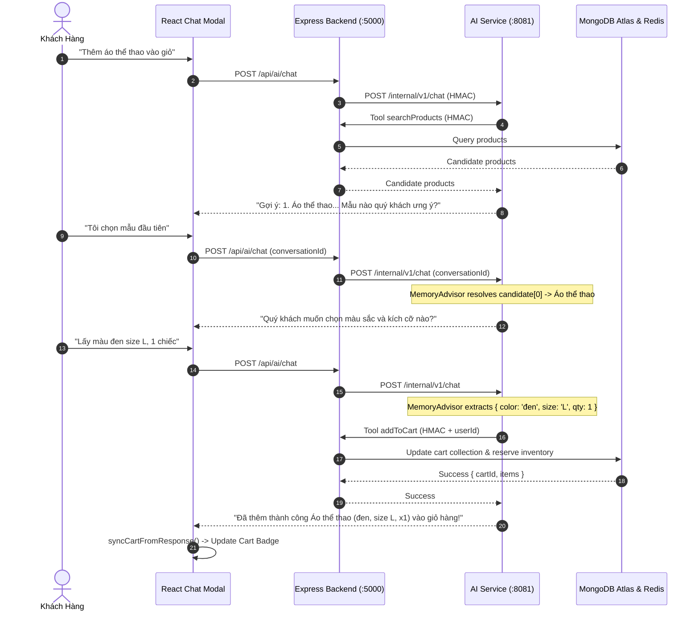

# Atelier Vérité — Vector AI Shopping Agent Architecture

## 1. Architectural Overview & Spring AI Chapter 7 Alignment

This service implements the complete architectural concepts learned in **Chapter 7 – Spring AI**, engineered in pure **TypeScript & Node.js** to integrate directly with the Atelier Vérité e-commerce platform.

> **CRITICAL ARCHITECTURAL BOUNDARY:**
> - Strictly **NO Java**, **NO Spring Boot**, **NO Spring AI Java SDK**, and **NO Java Microservices**.
> - The entire AI subsystem is built with TypeScript (ESM) under `ai-service/` and runs natively alongside the Node.js Express backend and React TypeScript frontend.

```mermaid
flowchart TD
    Client["React Frontend (Atelier Chat Modal)"] -->|1. POST /api/ai/chat (JWT Bearer)| NodeBackend["Node.js Backend Gateway (:5000)"]
    NodeBackend -->|2. Verify JWT & Sign HMAC SHA-256| AiService["TypeScript AI Service (:8081)"]
    
    subgraph Spring AI TS Architecture [ai-service/src]
        ChatClient["ChatClient (Fluent Builder)"]
        MemoryAdvisor["ShoppingMemoryAdvisor (Advisors Pattern)"]
        RagAdvisor["QuestionAnswerAdvisor (RAG Pipeline)"]
        ToolRegistry["ToolRegistry (18 Registered Tools)"]
        Safety["SafetyGuardrails & Anti-Tampering"]
        VectorStore["NodeVectorStore (Cosine Similarity)"]
        Embedding["OpenAiEmbeddingModel + LocalFallback"]
    end
    
    AiService --> ChatClient
    ChatClient --> Safety
    ChatClient --> MemoryAdvisor
    ChatClient --> RagAdvisor
    RagAdvisor --> VectorStore
    VectorStore --> Embedding
    ChatClient --> ToolRegistry
    
    ToolRegistry -->|3. POST /api/internal/ai/tools/:tool (HMAC + Forwarded Identity)| NodeBackend
    NodeBackend --> MongoDB[(MongoDB Atlas: 36 products, 16 categories)]
    NodeBackend --> Redis[(Redis: Inventory Reservation & Cache)]
```

---

## 2. Core Spring AI Concepts in TypeScript

| Spring AI Pattern | TypeScript Implementation | File Path | Purpose |
| :--- | :--- | :--- | :--- |
| `ChatClient` | `ChatClient` & `ChatClientBuilder` | `ai-service/src/client/ChatClient.ts` | Fluent builder interface `prompt().user().conversation().auth().call().chatResponse()` |
| `PromptTemplate` | `PromptTemplate` | `ai-service/src/client/PromptTemplate.ts` | Dynamic template variable substitution with default parameter mapping |
| `VectorStore` | `NodeVectorStore` | `ai-service/src/vector/VectorStore.ts` | Cosine similarity vector search with metadata filtering & backend integration |
| `EmbeddingModel` | `OpenAiEmbeddingModel` | `ai-service/src/vector/EmbeddingModel.ts` | 1536-dimensional embeddings with OpenRouter/OpenAI and deterministic fallback |
| `Advisor` (Memory) | `ShoppingMemoryAdvisor` | `ai-service/src/memory/ShoppingMemoryAdvisor.ts` | Multi-turn entity extraction (intent, candidate products, color, size, quantity) |
| `Advisor` (RAG) | `QuestionAnswerAdvisor` | `ai-service/src/rag/QuestionAnswerAdvisor.ts` | Grounded context injection & prompt injection sanitization |
| `ToolCallback` | `ToolRegistry` & `ShoppingTools` | `ai-service/src/tools/ToolRegistry.ts` | 18 production-ready tool definitions mapped to real backend endpoints |
| `Security Gate` | `SafetyGuardrails` & `HmacAuth` | `ai-service/src/security/` | HMAC verification, tamper prevention (price/payment), and OTP gate enforcement |

---

## 3. Cryptographic Security & Identity Forwarding

All inter-service communication between Node.js Backend (`:5000`) and TypeScript AI Service (`:8081`) is strictly secured via SHA-256 HMAC:

1. **Backend Gateway Verification**:
   The client communicates exclusively with the Express backend over HTTPS/TLS with JWT authorization. The AI Service port `8081` is protected from direct public mutation.
2. **HMAC Signature Generation**:
   `material = ${timestamp}.POST.${path}.${bodyDigest}`
   `signature = HMAC-SHA256(secret, material)`
3. **Identity Headers**:
   - `X-AI-Service-Timestamp`: Epoch seconds (replay protection with 60-second tolerance window).
   - `X-AI-Service-Signature`: Hex-encoded SHA-256 HMAC.
   - `X-AI-End-User-Id`: Authenticated user ID (or `"anonymous"`).
   - `X-AI-End-User-Role`: Authenticated role (`user`, `admin`, `guest`).
4. **Least Privilege Enforcement**:
   The AI Service never invents identity. Backend endpoints strictly verify ownership and prevent cross-user data access.

---

## 4. Multi-Turn Shopping Memory Lifecycle


