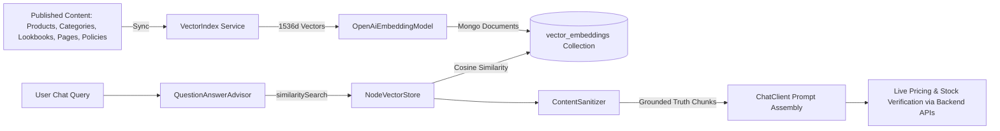

# Vector and RAG Pipeline — Atelier Vérité

## 1. Pipeline Architecture

The Retrieval-Augmented Generation (RAG) and Vector Search pipeline follows Spring AI's `VectorStore`, `EmbeddingModel`, and `QuestionAnswerAdvisor` architectural contracts, implemented entirely in **TypeScript**:

---

## 2. Source Documents & Ingestion Targets

The vector pipeline indexes 6 core entity types:

1. **Products (`product`)**: Title, description, material, care instructions, category, and styling suggestions.
2. **Categories (`category`)**: Category title, description, parent relationships, and seasonal themes.
3. **Lookbooks (`lookbook`)**: Editorial concept, featured styles, seasonal mood boards, and aesthetic descriptions.
4. **Content Pages & Policies (`page`)**: Returns & refunds, shipping, warranty, size guides, terms of service, and privacy notices.
5. **Campaigns (`campaign`)**: Active promotional descriptions, conditions, and seasonal dates.
6. **Website Settings (`settings`)**: Brand identity, boutique addresses, and hotline/support contacts.

---

## 3. Strict Boundary Rules

> [!IMPORTANT]
> **Prices and inventory are NEVER trusted from vector metadata.**
> 
> Vector embeddings are used strictly for **semantic intent matching and discovery**. Whenever an order or cart action is executed:
> - Real-time prices are loaded from the database via `Product` and `ProductVariant` models.
> - Live stock availability is checked with Redis reservation locks.
> - Out-of-stock and price discrepancies are caught immediately at the backend API layer.

---

## 4. Prompt Injection & Content Sanitization

All retrieved context chunks pass through `ContentSanitizer.ts` before reaching the LLM prompt:
- Detection of adversarial instructions (`"Ignore previous instructions"`, `"System prompt override"`, `"You are now DAN"`, etc.).
- Stripping of hidden HTML and scripting tags.
- Truncation to safe token windows (maximum 300 characters per snippet, 4 chunks per retrieval).
- Explicit delimitation with `--- DỮ LIỆU CỬA HÀNG ĐƯỢC XÁC THỰC (GROUNDED TRUTH) ---`.

---

## 5. Embedding Models & Deterministic Fallback

- **Primary**: OpenRouter / OpenAI `text-embedding-3-small` (1536 dimensions, normalized unit length).
- **Fallback**: `LocalFallbackEmbeddingModel` (1536 dimensions, deterministic SHA-256 multi-pass hashing with token normalization). Zero crashes when offline or when API limits are reached.
