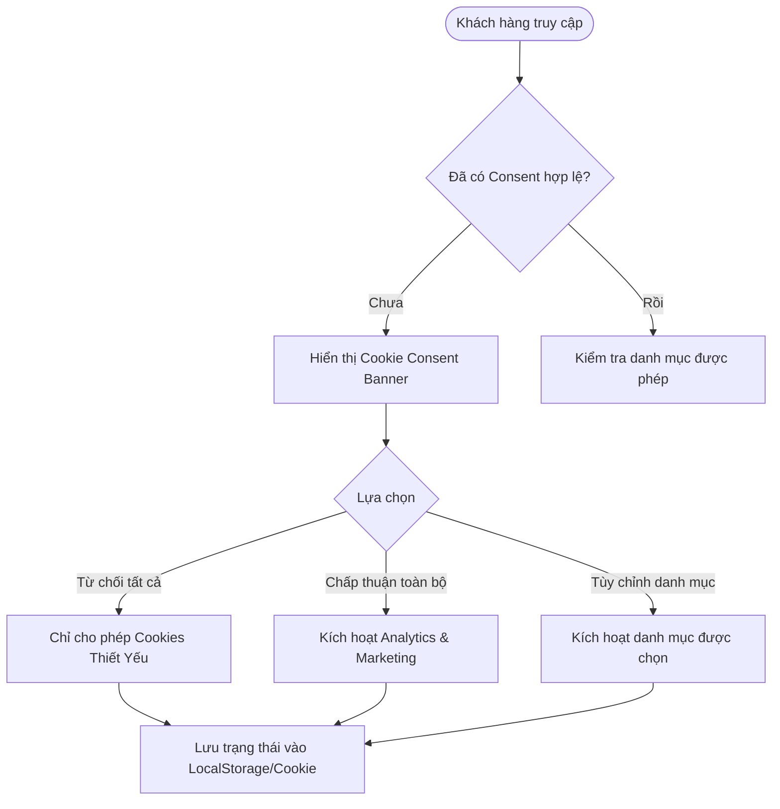

# Tracking & Privacy Compliance Architecture (Decree 13/2023/NĐ-CP & Law 91/2025/QH15)

## 1. Regulatory Context
Atelier Vérité operates an e-commerce platform handling customer data across Vietnam and international territories. This document formalizes the platform's architectural compliance with:
1. **Decree 13/2023/NĐ-CP (Nghị định 13/2023/NĐ-CP về Bảo vệ dữ liệu cá nhân)**:
   - Mandatory explicit consent prior to data processing.
   - Purpose limitation, retention minimization, and notification of rights.
   - Mechanism for Data Subject Rights (DSR) withdrawal, export, and deletion.
2. **Law 91/2025/QH15 (Luật Bảo vệ quyền lợi người tiêu dùng sửa đổi)**:
   - Transparency in digital tracking, automated recommendation algorithms, and targeted marketing disclosures.
3. **GDPR / ePrivacy Directives**:
   - Opt-in cookie banner prior to running analytical or marketing trackers.
   - Granular category selection (Necessary, Functional, Analytics, Marketing).

---

## 2. Privacy-by-Design Architecture

---

## 3. Data Minimization & Security Guardrails

### A. Zero Secret Ingestion Policy
Under no circumstances are the following data points logged, processed in tracking events, or rendered in administrative analytics:
- Plaintext passwords or hashed credentials
- One-Time Passwords (OTP) or 2FA codes
- JSON Web Tokens (JWT) or Refresh Tokens
- Full Payment Card Numbers (PAN), CVV/CVC codes, or banking PINs
- User-to-agent private chat message bodies

### B. Client-Side Telemetry Containment
- When a user rejects optional analytics cookies (`reject_all`), tracking scripts drop all client-side event dispatchers immediately.
- The platform's E2E test suite validates this containment via `e2e/privacyCompliance.spec.ts` (Test B & Test H), ensuring zero unsanctioned tracking beacons or requests reach external endpoints.

### C. Data Subject Rights (DSR) Handling
Users can execute their statutory rights under Decree 13/2023/NĐ-CP at `/data-privacy-request`:
- **Right to Access / Export (Quyền truy cập & xuất dữ liệu)**: Submits export request to backend queue.
- **Right to Rectification (Quyền cải chính)**: Update account profile and address information.
- **Right to Erasure / Deletion (Quyền xóa dữ liệu)**: Initiates pseudonymization or permanent deletion of non-accounting customer data.
- **Right to Withdraw Consent (Quyền rút lại sự đồng ý)**: Accessible at any time via the persistent Privacy Floating Badge or Footer Privacy Settings.

---

## 4. Administrative Oversight & Audit Trail
Administrators reviewing user analytics at `/admin/tracking` operate under strict role-based authorization:
- Data is aggregated into macro trends (total counts, category distributions, funnel cohorts).
- Individual session inspections are strictly bound to authorized debug workflows using pseudonymous session IDs.
- Direct cross-user snooping is architecturally prevented.
